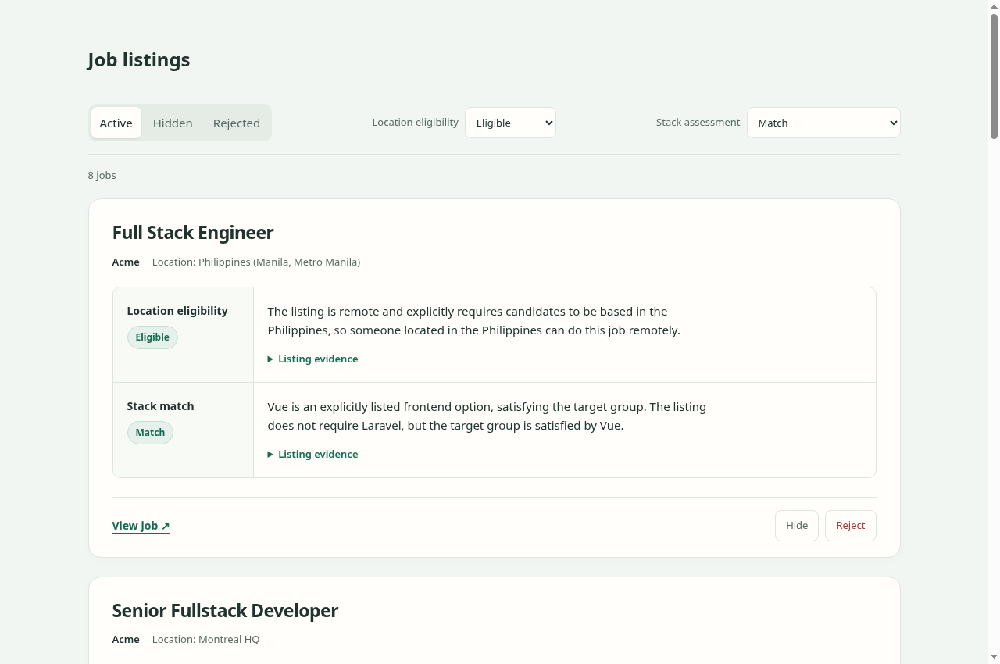

# Job Hunter

A personal tool for finding remote jobs that hire where you live and fit your tech stack.

Google search → Read job descriptions → ChatGPT location and stack checks.

Set your roles, skills, and location, then let it run. It finds listings on Ashby, Lever, and Greenhouse, reads the job descriptions, and checks location and stack fit so you don't have to open every listing yourself.



Browse the results in a local web UI. Filter by location or stack fit, hide jobs you're not interested in, and restore them later. Listings are deduplicated and saved in SQLite.

## Get started

You'll need **Node.js 22.18+**, **pnpm**, **Docker Compose**, an [Autom.dev](https://autom.dev) API key, and a **ChatGPT subscription**.

From your local checkout:

```sh
pnpm install
cp .env.example .env
```

1. In `.env`, set `AUTOM_API_KEY`.
2. Edit [`profile.ts`](profile.ts) with your location, job titles, skills, and search locations.
3. Build, sign in with ChatGPT using the URL printed by `auth`, and start everything:

```sh
pnpm build
pnpm job-hunter auth
docker compose up -d
```

Open **<http://localhost:3000>**. Compose runs the web UI, scheduled fetching, background reviews, and Firecrawl together. No systemd or host cron setup needed.

Fetching runs hourly in UTC, starting at the next hour. To get your first results right away:

```sh
pnpm job-hunter fetch
```

`fetch` queues a search and returns immediately; keep `workers` running to execute it and review new listings automatically. Duplicate requests while a search is queued or running are skipped. AI assessments can be wrong—check the original listing before applying.

## Make it yours

[`profile.ts`](profile.ts) controls what to search for and how to review it:

| Field | What to put there |
| --- | --- |
| `location` | Where you live, for hiring eligibility checks |
| `title` | Title groups: arrays mean AND; entries in each object mean OR |
| `searchLocation` | Places or work arrangements to search for, like `APAC` or `remote` |
| `skills` | Technologies to search for and compare against each job; same format as titles |

Each object lists alternatives. Its keys are technology or title names, and its values are other spellings of the same name. Use `[]` when there are no other spellings. Put multiple objects in the array to require a match from each group.

```ts
title: [
  { backend: ['back end', 'back-end'], frontend: ['front end', 'front-end'] },
  { developer: [], engineer: [] },
],
skills: [
  { Laravel: [], Vue: ['Vue.js', 'VueJS'], Nuxt: ['Nuxt.js', 'NuxtJS'] },
],
```

The title example looks for backend or frontend roles called developer or engineer, including the other spellings. Titles search only job titles; skills can appear anywhere on the page.

Each job gets a stack assessment. With Laravel, Vue, and Nuxt configured:

| Assessment | Example |
| --- | --- |
| Match | Laravel backend or Vue frontend |
| Partial match | Laravel + React |
| Potential match | React only |
| Unclear | No stack specified |

The check focuses on technologies used in the role, not bonus skills or passing mentions. Stack assessments don't automatically reject jobs.

After editing it, restart the workers:

```sh
docker compose restart workers
```

Optional settings in `.env`: `FETCH_CRON` changes the UTC fetch schedule, while `MODEL_NAME` and `MODEL_EFFORT` control the reviewer. `MODEL_PROVIDER` defaults to `chatgpt`, the only supported provider. After changing `.env`, run `docker compose up -d`.

## Usage

```sh
docker compose logs -f scheduler workers         # Follow activity
docker compose down                              # Stop everything
pnpm job-hunter fetch                            # Queue a search now
pnpm job-hunter jobs                             # List saved jobs
pnpm job-hunter stack-backfill                   # Queue missing stack checks
pnpm job-hunter review --limit 10                # Enqueue and wait; workers must be running
pnpm job-hunter repair                          # Restore missing unfinished tasks
pnpm job-hunter retry --stage stack --id 42      # Retry one exhausted stage
```

After updating the code, run `pnpm install && pnpm build`, then `docker compose up -d --remove-orphans --force-recreate web scheduler workers`. The orphan cleanup removes containers for services renamed by an update without deleting queue data.

Keep the worker running when using `review`. If a check fails, its stage and reason appear in the UI. Use `retry` to try that stage again, or `repair` to pick up unfinished work missing from the queue. `stack-backfill` adds missing stack checks, regardless of location eligibility.

Processing commands connect to Redis through `REDIS_URL` (localhost by default). Compose sets this for you and saves queue data in a Docker volume. Avoid `docker compose down -v` unless you want to delete that data.

Jobs and login tokens stay in this checkout (`jobs.sqlite` and `.auth.json`). Keep `.auth.json` private—it contains plaintext credentials. Sign in again with `pnpm job-hunter auth` if needed. The web UI is only exposed locally.

## Under the hood

TypeScript, SQLite, BullMQ/Redis, and a plain HTML/CSS/JS UI. Autom.dev provides Google results, public Ashby, Greenhouse, and Lever APIs read their listings, and ChatGPT checks location and stack independently. The existing Firecrawl stack remains provisioned but is not used for these supported listings.

The `scheduler` service queues searches; `workers` runs discovery, crawling, and both checks. Saved listing text is reused, each result saves as it finishes, and temporary review failures get up to three attempts.

Ashby extraction selects the exact listing UUID from the board's documented `jobUrl` values and saves the description together with location, workplace, employment, and compensation metadata. A successful board response without that UUID marks crawling terminal and blocks both checks; API errors, malformed posting URLs, and empty descriptions use normal retries. There is no Firecrawl fallback for Ashby. Previously saved text and assessments are unchanged.

Searches use Autom credits. Failed searches are logged without automatically retrying the whole run; the next scheduled or manual request can run again. Queued searches wait while `workers` is offline, but scheduled ticks are missed while the scheduler is offline. ChatGPT access uses an unofficial subscription endpoint, so upstream changes may break it.

For local development:

```sh
pnpm check
pnpm test
docker compose --profile test up -d redis-test
pnpm test:queue  # Optional queue integration checks
```

Tests make no live API calls. `pnpm test` needs no Redis or Docker. The optional `pnpm test:queue` checks require a separate test Redis at `redis://127.0.0.1:6380` (or `TEST_REDIS_URL`); the command above starts one. Tests clean up their isolated queue namespaces and temporary storage, not the Redis service. Stop it afterward with `docker compose --profile test stop redis-test`.
